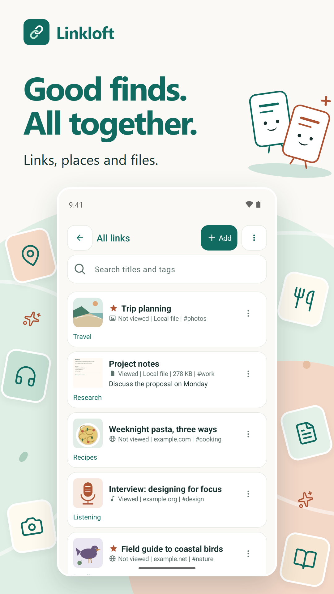
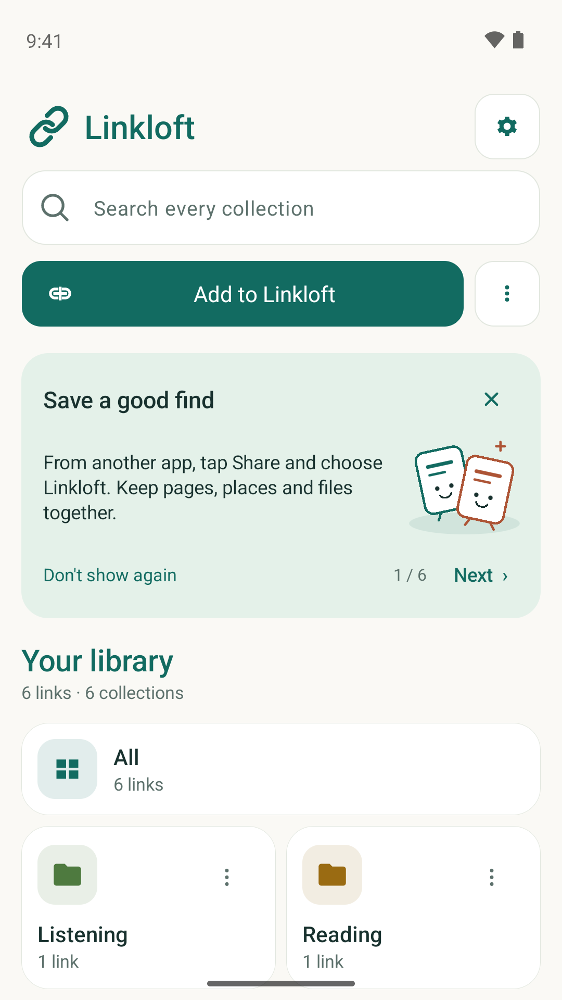
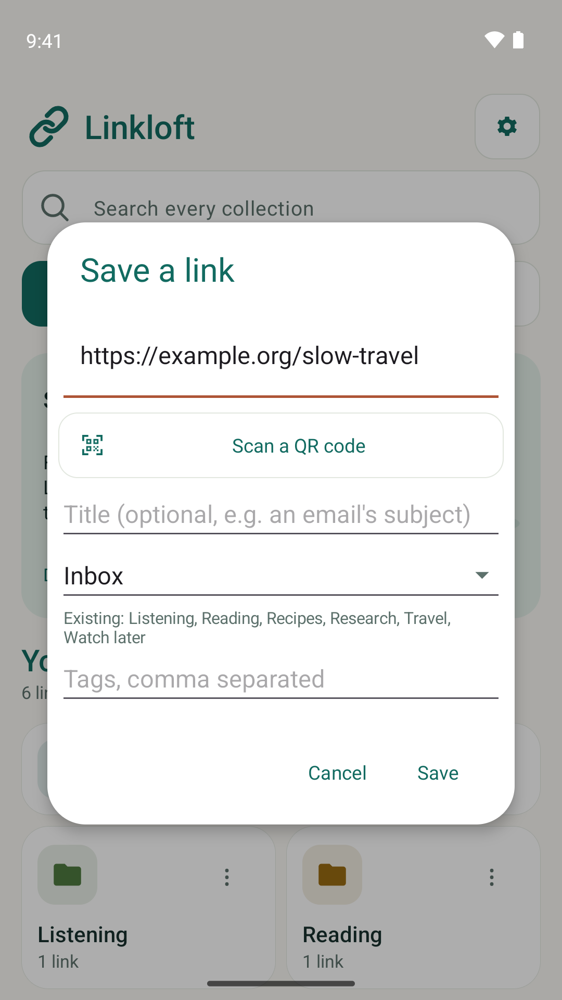

# Linkloft

**Save links, videos, music, places and files in one Android library.**

A YouTube video to watch, a Spotify album to try, a place from Google Maps, an article to read, a document to keep nearby: Linkloft brings your saved finds together so you can organise them and find them again.

[Get Linkloft on Google Play](https://play.google.com/store/apps/details?id=app.linkloft) · [Releases](https://github.com/simdalb/linkloft-releases/releases) · [Website](https://linkloft.app/)

**Current availability:** Stable version 0.6.0 is available on Google Play. Direct APK distribution is being prepared; use Google Play until a stable APK is published under Releases.

## What you can save

- Web pages, articles and useful links.
- YouTube videos and other video links.
- Spotify music, albums, playlists and other audio links.
- Google Maps places and other supported map links.
- References to documents, pictures and other local files on your device.

Use **Share → Linkloft** from another app, or add an item inside Linkloft. Organise your library with collections, tags, favourites and personal notes. Search saved titles and tags without an internet connection.

Linkloft saves links to online content. Watching a video, listening to music or opening a website still uses the original service and may require internet access or an account with that service. Local-file entries refer to files on your device.

## Your library, on your phone

- No Linkloft account required.
- The current public Basic release is free, with no ads or subscriptions.
- Export your library as JSON, CSV or browser-bookmark HTML.
- Import supported bookmark exports and make manual folder or HTTPS WebDAV backups.
- Choose from 36 interface languages.
- Android 8.0 or later.

Your saved library is stored locally. Optional online previews contact content providers, and some Google components send diagnostic and usage data. Read the [privacy policy](https://linkloft.app/privacy) for details. This APK is the public Basic edition; it is not a Google-services-free edition.

## App screenshots

Sample content is shown.

 

## Install and update

Google Play is the easiest option for most users. If you prefer a direct download, open [Releases](https://github.com/simdalb/linkloft-releases/releases), choose the latest stable version and download its `.apk` file. The matching `SHA256SUMS.txt` records the file checksum.

Public APKs here are downloaded from Google Play Console and retain Google's app-signing identity. Install updates over the existing app to keep your library. If Android reports a signing conflict, do not uninstall your existing app to work around it; [contact support](https://linkloft.app/feedback) first.

Direct-download users can follow this repository's releases or [subscribe to optional release emails](https://linkloft.app/updates#email-updates). Google Play may also offer a compatible newer release when it is available to your account and device. This repository does not provide an automatic APK updater.

## Feedback and support

[Send private feedback](https://linkloft.app/feedback) · [Ideas and progress](https://linkloft.app/ideas) · [What's new](https://linkloft.app/updates) · [Privacy](https://linkloft.app/privacy)

Please include your Linkloft version and Android version when reporting a problem. Do not post your saved library, personal links or private diagnostic details publicly.

This is Linkloft's official public download repository. The application's source code is maintained separately and is not published here. Linkloft is an independent app and is not affiliated with YouTube, Spotify or Google Maps.
